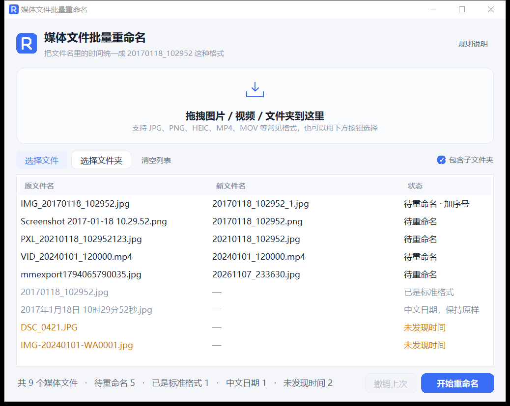

# 媒体文件批量重命名

把照片、视频文件名里的时间信息，统一成 `20170118_102952` 这种格式。
拖进去 → 看预览 → 一键改名，不满意可以撤销。



## 快速开始

**方式一（推荐，免装 Python）**

双击 `媒体文件重命名.exe`。单文件、无依赖，拷到别的电脑上也能直接跑。

**方式二（从源码运行）**

双击 `启动.bat`，它会自动找一个带 tkinter 的 Python 并启动界面。
手动运行也可以：

```bash
python main.py
```

## 使用步骤

1. 把图片、视频或整个文件夹**拖进窗口**（也可以用「选择文件 / 选择文件夹」按钮）
2. 列表会立刻列出每个文件的**原名、新名、状态**——这一步不会动磁盘
3. 需要连子目录一起处理时，勾选右侧「包含子文件夹」
4. 点「开始重命名」，确认后执行
5. 改错了点「撤销上次」还原

双击列表里任意一行，可以直接在资源管理器里定位到该文件。

## 识别规则

只有能从文件名里读出**完整的年月日 + 时分秒**才会改名，统一输出 `YYYYMMDD_HHMMSS.原后缀`。

| 文件名示例 | 解析结果 |
| --- | --- |
| `IMG_20170118_102952.jpg` | `20170118_102952.jpg` |
| `Screenshot 2017-01-18 10.29.52.png` | `20170118_102952.png` |
| `2017-01-18 10:29:52.mp4` | `20170118_102952.mp4` |
| `20170118102952.jpg`（紧凑 14 位） | `20170118_102952.jpg` |
| `PXL_20210118_102952123.jpg`（后带毫秒） | `20210118_102952.jpg` |
| `mmexport1794065790035.jpg`（13 位毫秒时间戳） | `20261107_233630.jpg` |
| `wx_camera_1698765432.jpg`（10 位秒时间戳） | `20231031_231712.jpg` |

下面这些情况**保持原样**，只在状态列里标注原因：

| 情况 | 示例 | 状态 |
| --- | --- | --- |
| 已经是目标格式 | `20170118_102952.jpg`、`20170118_102952_1.jpg` | 已是标准格式 |
| 中文日期写法 | `2017年1月18日 10时29分52秒.jpg` | 中文日期，保持原样 |
| 文件名里没有时间 | `DSC_0421.jpg` | 未发现时间 |
| 只有日期没有时分秒 | `IMG-20240101-WA0001.jpg` | 未发现时间 |
| 不是图片或视频 | `notes.txt` | 直接忽略 |

时间戳（10 / 13 / 16 位）按**本机时区**换算。

支持的格式：`.jpg .jpeg .png .gif .bmp .webp .tif .tiff .heic .heif .avif .svg` 等图片，
`.mp4 .mov .avi .mkv .wmv .flv .m4v .mpg .mpeg .3gp .ts .m2ts .webm .rmvb` 等视频。

## 安全设计

- **只改名，不移动**：文件始终留在原文件夹，扩展名和大小写都保持原样
- **不覆盖**：同一秒的多个文件会自动加 `_1`、`_2`，并避开磁盘上已存在的同名文件
- **先预览后执行**：列表只是方案，点「开始重命名」并二次确认才会真正动文件
- **可撤销**：「撤销上次」会把最近一批改回原名（重新扫描列表后该记录会失效）

## 快捷键

| 快捷键 | 作用 |
| --- | --- |
| `Ctrl + O` | 选择文件 |
| `Ctrl + Shift + O` | 选择文件夹 |
| `Ctrl + Enter` | 开始重命名 |
| `Ctrl + Z` | 撤销上次 |

## 目录结构

```
rename/
├─ 媒体文件重命名.exe      打包好的单文件程序
├─ 启动.bat                从源码启动（自动寻找 Python）
├─ 打包.bat                重新打包 exe
├─ main.py                 入口
├─ core/
│  ├─ timeparse.py         从文件名里提取时间
│  └─ renamer.py           扫描、生成方案、执行、撤销
├─ ui/
│  ├─ app.py               主窗口
│  ├─ theme.py             配色与样式
│  └─ widgets.py           自绘的圆角按钮、拖放区、勾选框、R 标志
├─ build/
│  ├─ logo.svg             R 字母标志源文件
│  ├─ app.ico              多尺寸图标（exe 与窗口共用）
│  ├─ make_icon.py         由 logo.svg 生成 app.ico
│  └─ screenshot.png       README 截图
└─ vendor/tkinterdnd2/     内置拖拽库，免 pip 安装
```

## 自己打包

双击 `打包.bat`。首次运行会做三件事：建一个 `.buildenv` 虚拟环境、装 PyInstaller、生成图标，然后打包到根目录。

核心命令等价于：

```bat
pyinstaller --noconfirm --clean --onefile --windowed ^
    --name "媒体文件重命名" --icon build\app.ico --paths vendor ^
    --collect-all tkinterdnd2 --add-data "build\app.ico;." ^
    --workpath .pyi-build --specpath . --distpath . main.py
```

几个参数不能省：`--paths vendor` 让 PyInstaller 找得到内置的 tkinterdnd2；
`--collect-all tkinterdnd2` 才会把它依赖的 tkdnd 动态库一起打进去，否则拖拽会失效；
`--workpath` 必须改，否则会和项目自己的 `build/` 目录撞名。

## 换图标 / 换 Logo

标志的几何定义在 `build/logo.svg`（96×96 网格）。改完执行：

```bash
python build/make_icon.py
```

脚本会用 Edge 无头模式渲染一张大图，自动裁掉透明边，再用纯 Python 按面积平均缩放到
16/20/24/32/40/48/64/128/256 九种尺寸并打包成 `app.ico`——不依赖 Pillow。
之后重新打包即可。

界面左上角那个小标志不是图片，而是 `ui/widgets.py` 里的 `draw_r_mark()` 用 Canvas
矢量画出来的，任何缩放比例下都清晰。

## 常见问题

**双击 exe 后要等一两秒才出界面？**
单文件 exe 启动时要先解包到临时目录，属于正常现象。介意的话可以改成打包成文件夹形式（去掉 `--onefile`），启动会快很多但会多出一堆 dll。

**杀毒软件报毒？**
PyInstaller 打包的程序被误报很常见，不是真的有毒。加白名单即可，或者直接跑源码版本。

**拖拽没反应？**
极少数系统缺少 tkdnd 运行库时会自动降级，此时窗口里的提示会变成「当前环境不支持拖拽」，用按钮选择文件一样能用。

**时间解析出来差了几个小时？**
10/13 位时间戳是按本机时区换算的。如果原始文件是别的时区拍的，结果会有偏移。

**撤销为什么是灰的？**
只有刚执行完一批重命名才可用，并且重新扫描列表后会被清空（避免改错文件）。

## 环境要求

- Windows 10 / 11 64 位
- 直接运行 exe：无需安装任何东西
- 从源码运行：Python 3.8+，且安装时勾选了 `tcl/tk and IDLE`
- 重新打包：需要联网安装 PyInstaller，以及本机装有 Edge 或 Chrome（用于生成图标）
